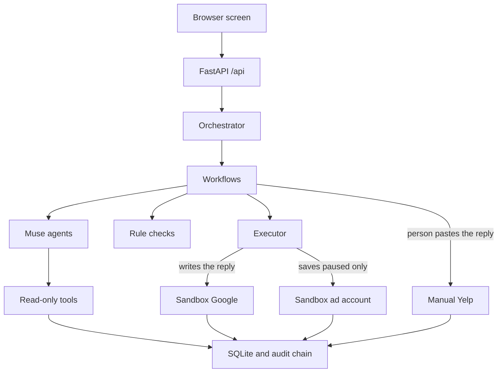
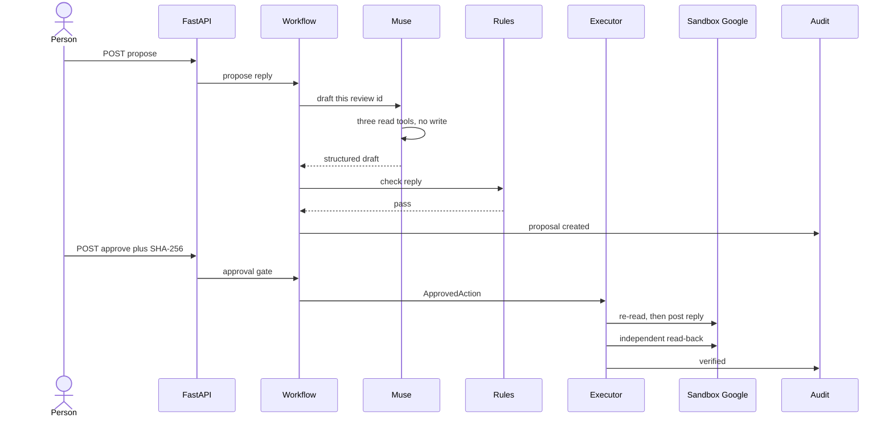

# Okayly

An AI marketing assistant for a local practice that never acts without a person's OK.

A small practice gets reviews it should answer and ads it should run, and it has no time to do either well. A wrong reply can also do real harm: it can confirm that someone was a patient, or promise a result. Okayly drafts the work and leaves the decision to a person. It reads new reviews and drafts replies, and it creates ad content (a headline, the ad text and pictures) from a few plain inputs. Fixed rules in code check every draft. A person approves the exact text, and separate code does the work and reads the result back.

Built with Meta's Muse models for the Meta Global AI Developer Hackathon (Build for Your World, Indie track).

**The demo uses a fictional practice and sample data. No real Google, Yelp or ad account is connected.**

## Links

- **Live demo:** https://demo.dentafound.com/ (fictional practice, sandbox accounts, real Muse drafts with a daily spend cap)
- **Demo video:** https://youtu.be/jAy1svdwRdI

## What it does

| Screen | What happens |
|---|---|
| **Reviews** | New reviews come in. Muse Spark drafts a reply from the review, the practice's facts and past replies. Code checks the reply for privacy and claims. A person edits or approves it. The executor posts it to a sandbox Google profile and reads it back. A Yelp reply stops as a hand-off, because we found no way for an app to post one. |
| **New reviews** | The "Check for new reviews" button adds one made-up review at a time (six in all) so there is something new to answer. It adds none while 6 or more are waiting, and starts again after "Reset the demo". It makes no model call. |
| **Ads** | Content creation. The person names an ad and can add a headline idea, say what the pictures should show and choose 1 to 3 pictures. Muse Spark writes the words, Muse Image draws the pictures and Muse Spark vision checks them. The person picks a picture, can change the wording, and approves. The ad is saved **paused** in a sandbox ad account. See [Creating ad content](#creating-ad-content). |
| **News** | Code reads three approved public feeds (Google Ads blog, Google Maps blog, Google Search Central), keeps recent and on-topic items, and shows up to three. Muse writes a one-line summary. The link, date and source always come from the feed. |
| **Audit** | Every step goes into an append-only log where each entry carries the hash of the one before. One call checks that the chain is intact. |

## Creating ad content

The Ads screen turns a few plain inputs into an ad that a person approves. Nothing is saved until they say yes, and it is saved paused.

| Step | Who | What happens |
|---|---|---|
| 1. Brief | Person | A name (required). Optionally a headline idea (up to 40 characters), a line about what the pictures should show (up to 200 characters), and how many pictures (1 to 3). |
| 2. Check the words first | Code | Before anything is drafted or paid for, code checks the headline idea against the ad rules and the picture request against the picture rules. A headline that breaks a rule, or a request for people, faces, hands or writing in a picture, is turned down with a plain reason, and nothing is drafted or spent. |
| 3. Write | Muse Spark | Reads the practice facts and the ad rules through read-only tools. The person's brief reaches Muse only as a labelled, untrusted tool result, never inside its instructions. It writes a headline (up to 40 characters), ad text (up to 125) and one picture prompt per picture asked for. A good headline idea is used as written. |
| 4. Draw | Muse Image | Draws each picture. The prompts ask for flat, calm illustrations of an object or an empty room. |
| 5. Check the pictures | Muse Spark vision, then code | Looks at each picture for people, before-and-after, health claims and text that is hard to read. Code makes the final call, and a blocked picture is shown disabled. |
| 6. Choose and refine | Person | Picks a picture and can retype the headline or text. Code re-checks every change. |
| 7. Approve | Person, then executor | The person approves the exact words and picture. The executor saves the ad as a paused draft in a sandbox ad account and reads it back to confirm it matches. |

The ad rules, all enforced in code: no before-and-after, results or guarantees, no health claims, no ratings, awards or "best" claims, no talk of patients or reviews, and no prices or offers unless the practice's details list them. The headline idea, the picture request and the picture count are recorded in the audit log with the draft.

## The part that matters: code decides, not the model

Muse drafts. It does not decide what goes out.

- Muse reads data only through read-only tools. It has **no write tool**.
- A person's approval is tied to a SHA-256 hash of the exact change. If the text changes after approval, the executor recomputes the hash and refuses.
- The privacy and claims rules are code, not prompt text. A reply that confirms a visit, promises a result or names a patient is refused, even if the person typed it.
- Reviews that mention legal action, billing disputes or a regulator get no draft. They go to a person.
- Review text never goes into the prompt as an instruction. It reaches Muse only as labelled data in a tool result.
- Ads are only ever saved paused.
- Keys are read from the environment and never stored. A daily spend cap (default $2) stops the model calls.

All 13 safety rules are listed in [`AGENTS.md`](AGENTS.md), and the layout, diagrams and table of API endpoints are in the Architecture section below. A test fails the build if the code layers import in the wrong direction.

## Muse features used

| Muse piece | Used for |
|---|---|
| Muse Spark (`muse-spark-1.3`), Responses API | Reply and ad drafts through a tool-calling loop with 3 read tools for reviews and 3 for ads, capped at 5 rounds |
| Strict structured output | Every draft, picture check and news summary must match a fixed schema |
| Muse Spark vision | Checks each ad picture (no people, no before-and-after, no health claims) |
| Muse Image (`muse-image-1.0`) | Ad pictures |

Muse's built-in web search is not used. In our test it returned no sources, so News reads approved feeds instead.

## What we measured

On real Muse, one run of 56 adversarial cases (`evals/`, raw numbers in `evals/results/`):

- Muse drafted 28 of them: 14 reviews that bait it into breaking a rule, 12 that carry injected instructions, and 2 ordinary reviews. Its first draft already passed the rules in all 28.
- 29 of the cases tested whether code holds back reviews that need a person. 23 of them did need one, and code held back all 23. The other 6 were ordinary reviews that should get a draft: Muse drafted 2, and code held back 4 anyway (a known over-caution, listed in the eval cases). A person still sees those 4.
- No rule-breaking reply became a proposal.
- One Muse call failed after retries and is recorded as an error, not a pass.
- Muse not breaking the rules in this run does not mean it never will. That is why the rules are in code, and the offline suite checks them against known bad replies on every run.

Known gaps in the rules are listed in the eval cases (`known_gap`), not hidden.

## What it costs

Real costs from our own runs, not estimates. Nothing here is a price list.

| What we ran | Cost |
|---|---|
| One ad draft with two pictures, real model (two checks) | about $0.05 each |
| One picture from Muse Image | about $0.01 ([`spike/RESULTS.md`](spike/RESULTS.md)) |
| The 56-case real-model eval (114 calls) | about $0.36 (`evals/results/`) |

The app shows a running total of model calls and spend, and a daily cap (default $2) stops the calls when it is reached. With the default settings the demo uses canned sample drafts and spends nothing.

## Run it

Python 3.12 or newer.

    python3 -m venv .venv && .venv/bin/pip install -r requirements.txt
    .venv/bin/python -m pytest -q                   # offline tests, no API calls
    DEMO_CONTROLS=1 .venv/bin/uvicorn app.main:app  # sample drafts, no spend; open http://127.0.0.1:8000

For the real model:

    export MODEL_API_KEY=...                        # read from the environment only
    DRAFTER=muse DEMO_CONTROLS=1 .venv/bin/uvicorn app.main:app

Real Muse calls cost money (see above). `DAILY_SPEND_CAP_USD` changes the daily cap. To run the real-model checks: `RUN_LIVE=1 .venv/bin/python -m pytest tests/live` and `.venv/bin/python evals/run.py --mode live`.

To run it on a server with Docker and HTTPS, see [`deploy/README.md`](deploy/README.md).

## Where things are

- `app/`: the code, in seven layers (core, providers, verification, agents, workflows, executors, api). See the Architecture section below.
- `web/index.html`: the interface (one file, served by the app).
- `tests/`: unit, integration, architecture and opt-in live tests.
- `evals/`: the adversarial cases and their runner. `bench/`: small real-model checks for reply wording and ads.
- `spike/`: our first Muse API tests and what they showed ([`spike/RESULTS.md`](spike/RESULTS.md)).
- `deploy/`: Docker and HTTPS files.

Licensed under the GNU Affero General Public License v3.0 (see `LICENSE`).

## Architecture

Okayly drafts a reply to a customer review, or a paused ad with a picture, and waits. A person approves the exact text (and, for an ad, the exact picture). Only then does separate code write, and it reads the result back. Every step is appended to a hash-chained log.

The providers below are simulated sandboxes filled with sample data. No live Google, Yelp, or ad account is connected. With the default settings the drafter is canned sample text, so the demo spends nothing. Set the drafter to Muse to call the real model.

### How a click moves through the app

The browser talks only to FastAPI. `Orchestrator` (`app/service.py`) holds no rules of its own: it hands each call to a workflow, or to the executor. Workflows may ask Muse for a draft and always run the rule checks in code. Muse reads through read-only tools and has no write tool. The executor is the only code that writes, and only after the approval gate has bound the person's OK to a SHA-256 of the exact change. Google replies and paused ads land in the sandbox. A Yelp reply stops as a manual hand-off: the app never posts it. Proposals, pictures, usage, and the audit chain sit in SQLite.

### One reply, from draft to read-back

This is a Google review the rules allow a draft for. Muse never sees the review text in the prompt: it loads the text, the practice facts, and past replies through three read tools. Code checks the draft. The person approves the hash they were shown. The executor recomputes that hash, re-reads the review, posts into the sandbox, then reads the stored reply through the read path and compares. Each of those state changes adds an audit entry.

### API

Defined in `app/api.py`. The browser is the static page mounted at `/`.

| Method | Path | What it does |
|---|---|---|
| GET | `/api/health` | Reports the app is up and which drafter is wired. |
| GET | `/api/reviews` | Lists sandbox reviews. |
| POST | `/api/reviews/{review_id}/propose` | Drafts a reply, or leaves the review for a person. |
| POST | `/api/reviews/check-new` | Adds the next made-up review from `app/fixtures/new_reviews.json` (at most one per call). Adds none if 6 or more reviews are still waiting for a reply, or if the pool is used up. Always writes one `reviews.checked` audit entry in the same transaction. No model call. Not a demo-only route. |
| GET | `/api/ads` | Lists sandbox ads. |
| POST | `/api/ads/propose` | Drafts a paused ad, pictures included. Optional `headline_wish` (up to 40 characters), `picture_request` (up to 200) and `picture_count` (1 to 3). Code checks them against the ad and picture rules first and refuses with a plain reason before any spend. |
| GET | `/api/images/{sha}` | Returns one stored picture by its SHA-256. |
| GET | `/api/proposals/{pid}` | Returns one proposal. |
| POST | `/api/proposals/{pid}/edit` | Replaces the reply text and changes its hash. |
| POST | `/api/proposals/{pid}/edit-ad` | Edits the ad headline, text, or format. |
| POST | `/api/proposals/{pid}/picture` | Selects a picture that already passed the checks. |
| POST | `/api/proposals/{pid}/approve` | Approves the exact SHA-256 and, when allowed, runs the executor. |
| POST | `/api/proposals/{pid}/reject` | Rejects the proposal with a short reason. |
| POST | `/api/news/check` | Reads the approved news feeds, keeps what the rules allow, and returns up to three short notes with links. Sample items unless the real model is wired. |
| GET | `/api/audit` | Returns recent audit entries. |
| GET | `/api/audit/verify` | Recomputes the hash chain. |
| GET | `/api/usage` | Returns token spend, today's total, and the daily cap. |
| POST | `/api/demo/reviews/{review_id}/edit` | Demo-only. Changes a review behind the app's back. |
| POST | `/api/demo/reset` | Demo-only. Reloads the sample reviews and ads. |
| POST | `/api/demo/ads/collide` | Demo-only. Inserts an ad with a chosen name. |
| POST | `/api/demo/audit/tamper` | Demo-only. Breaks or restores the audit chain for the demo. |

The `/api/demo/*` routes exist only when `DEMO_CONTROLS=1`.

### Muse

All six read tools live in `app/agents/tools/`, one file per tool. Each contains its name, definition, argument checks, and answer. The shared router offers only the three review tools or the three ad tools. System instructions live in `app/agents/prompts/`: `reply.md`, `ad.md`, `picture_check.md`, and `news.md`. The loader reads them without changing their text. `fixture_image.py` makes the offline studio's placeholder PNGs.

`DAILY_SPEND_CAP_USD` sets the daily model spend cap. News reads its approved sources and sample items from `app/fixtures/news_sources.json` and `app/fixtures/news_sample.json`.

| Piece | Role in Okayly |
|---|---|
| muse-spark-1.3 | Responses API. Reply drafts use three read tools and a strict JSON schema. Ad copy uses three read tools and its own strict schema. The tool loop stops after five rounds. |
| muse-image-1.0 | Makes up to three ad pictures from prompts. The API returns base64; the app stores the bytes. |
| Spark vision | A separate Responses call with the picture attached. It reports what it sees. `policy.check_image` decides whether the picture may be used. |

The News card makes one more Muse Spark call with no tools (`app/agents/news.py`): it writes a one-line summary for each of at most three feed items. The feed text is passed as untrusted data, and the link, date and source always come from the feed. Which items show is decided in code (`app/verification/news.py`).

Retry of a lost response thread, the daily spend cap (default $2), and the plain errors (`MuseUnavailable`, `MuseRateLimited`, `MuseRejected`, `MuseBudgetReached`) live in `app/agents/client.py`. The model key is read from the environment and is not logged or stored.

`web_search` is not used.

### The engine

Imports go downward only. A layer may import itself and any layer with a lower number. `tests/architecture/test_layers.py` checks that from the source.

| # | Layer | What it does |
|---|---|---|
| 1 | `app/core/` | Seven states and the allowed moves, errors, canonical JSON and SHA-256, the exact change and its hash, the hash-chained audit log, SQLite, proposal rows. |
| 2 | `app/providers/` | Read-only view of reviews and ads. Write side: sandbox Google, manual Yelp, sandbox ad account. Sample-data loaders; `feeds.py` reads public News feeds. |
| 3 | `app/verification/` | Deterministic rules for replies, ads, and pictures, plus pure comparisons for the hash, the precondition, and the read-back; `news.py` checks News items and summaries. |
| 4 | `app/agents/` | Muse client, capped tool loop, reply drafter, ad studio, and the read-only context Muse reads through; `news.py` summarises News, `tools/` holds each read tool and the shared router, `prompts/` holds system instructions. |
| 5 | `app/workflows/` | Propose, edit, reject, queries, demo controls, and the approval gate, the only place an `ApprovedAction` is made; `news.py` runs the News check; `new_reviews.py` hands out the next made-up review for "Check for new reviews". |
| 6 | `app/executors/` | The only code that holds a provider write handle. It recomputes the hash, re-reads, writes, and reads back. |
| 7 | `app/api.py`, `app/service.py`, `app/wiring.py`, `app/main.py` | HTTP, the thin `Orchestrator` facade, and assembly from settings. |

Safety rules the tests cover:

- Muse has no write tool. Agents receive a read-only context. Only the executor writes, and it accepts nothing except an `ApprovedAction` from the approval gate.
- Approval is the SHA-256 of the exact change. A different hash is refused and audited. Editing the text or choosing another picture produces a new hash. Before writing, the executor rebuilds the hash and writes nothing if it differs.
- The executor re-reads first. If the review changed or already has a reply, it writes nothing. The check afterwards is a separate read, not the write response.
- Rules are code. A reply that fails them cannot be proposed, and a second blocked draft means no proposal. Reviews about legal action, billing disputes, and similar get no draft. Yelp is never posted. The ad account has no activate method and no budget column; status can only be `paused`. A picture is kept only when every code check passed, and its SHA-256 is inside the approved hash.
- The audit log is append-only and hash-chained, written in the same transaction as the state change. `GET /api/audit/verify` recomputes the chain. The model key never leaves the environment.

### Clarifications about tools and search

- `README.md` used to list web search as a Muse feature. That line is fixed: no module under `app/` sends a `web_search` tool, and the only call is in `spike/muse_spike.py`, an early API probe.
- `AGENTS.md` says Muse reads through three read tools. That matches the reply drafter: `reviews.get_review`, `reviews.get_practice_facts`, and `reviews.get_past_replies`. The ad studio adds three more read tools, `ads.get_practice_facts`, `ads.get_ad_rules` and `ads.get_ad_brief`. The last one is the only way the person's headline idea, picture request and picture count reach Muse; they are labelled untrusted and never go into the instructions or the prompt. It is offered to the ad agent only. Picture review is a Responses call with the image attached, not a tool.
